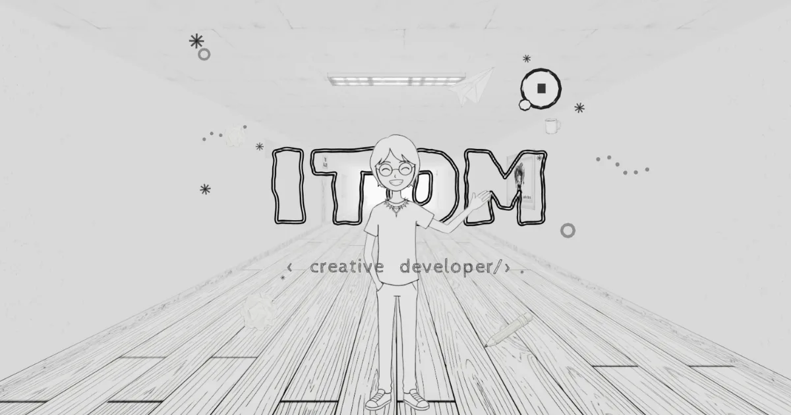
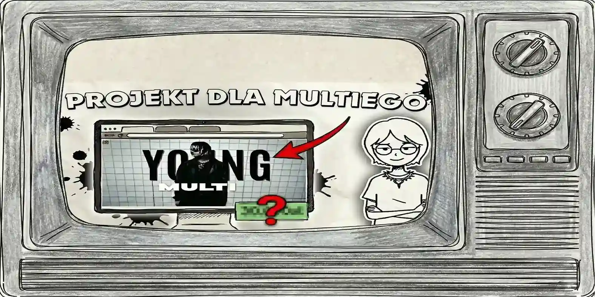
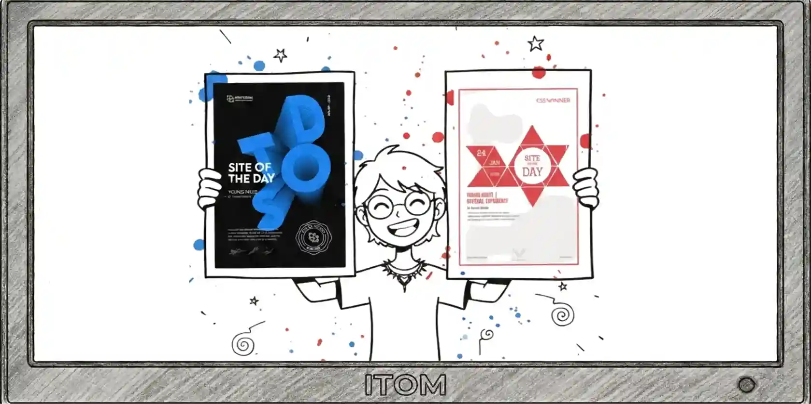

<div align="center">



# Vansh Dhiman — Interactive 3D Portfolio

**A hand-crafted, immersive 3D portfolio built with Three.js, React & GSAP.**

[](https://powerisvansh.github.io/)
[](https://threejs.org/)
[](https://react.dev/)
[](https://gsap.com/)
[](https://vitejs.dev/)

[Explore the studio](https://powerisvansh.github.io/) · [About](https://powerisvansh.github.io/?/about) · [Gallery](https://powerisvansh.github.io/?/gallery) · [Contact](https://powerisvansh.github.io/?/contact)

</div>

---

## About

This is not a normal portfolio. Instead of scrolling through plain sections, you walk through a **hand-painted 3D world** — an entrance, an about-map, a studio with a working TV, and a contact zone. Every texture is painted, every sound is placed, and every transition is animated.

Built as a study project while pursuing **Instrumentation & Control Engineering**, blending the engineering mindset with creative front-end craft.

<div align="center">


</div>

## Features

- **Fully interactive 3D scene** — walk around a painted studio, open doors, turn on the TV
- **Smooth SPA experience** — client-side routing with GitHub Pages fallback (`404.html`)
- **Cinematic loading screen** — paper-texture preloader with progress
- **Custom cursor + sounds** — ambient city, sea & monitor sounds; door and balloon SFX
- **Responsive** — works on desktop & mobile
- **Performance-minded** — compressed `.webp` textures, gzipped assets, lazy 3D chunks

## Tech Stack

| Layer | Tools |
| --- | --- |
| 3D & Animation | Three.js, React Three Fiber, GSAP |
| Frontend | React, Vite |
| Styling | CSS (custom), Google Fonts (Caveat, Gloria Hallelujah, Inter) |
| Assets | Hand-painted WebP textures, KTX2/GLB models, WebAudio sounds |
| Hosting | GitHub Pages (root domain `Powerisvansh.github.io`) |

## Sections

| Section | Description |
| --- | --- |
| **Entrance** | First touch — doors, avatar window, intro animation |
| **About** | A hand-drawn map with skill balloons (HTML, Git, GSAP, Firebase…) |
| **Studio** | TV with project films, monitors, phone with socials |
| **Gallery** | Pinned memories on a painted board |
| **Contact** | A boat, a sea, and a way to reach me |

## Run Locally

```bash
git clone https://github.com/Powerisvansh/Powerisvansh.github.io.git
cd Powerisvansh.github.io
npm install        # if you rebuild from source
npm run dev
```

> This repo currently ships the production build (`index.html` + `assets/`). It can be served with any static server:
>
> ```bash
> npx serve .
> ```

## Project Structure

```
├── index.html            # SPA entry + preloader
├── 404.html              # GitHub Pages SPA fallback
├── assets/               # JS bundles, CSS, compressed textures
├── textures/             # Hand-painted WebP textures (entrance, about, studio…)
├── images/               # Maps, pins, ink splashes, avatars
├── sounds/               # Ambient & interaction sounds
├── fonts/                # Hand-drawn display fonts
├── videos/               # Scrub video for the TV
└── .github/workflows/    # Auto-deploy to GitHub Pages
```

## Deployment

Pushed to `main` → GitHub Actions (`actions/deploy-pages`) publishes automatically to **https://powerisvansh.github.io/**

## Author

**Vansh Dhiman**
Instrumentation & Control Engineering student · builder of AI apps, automation & embedded projects

[GitHub @Powerisvansh](https://github.com/Powerisvansh) · [Live site](https://powerisvansh.github.io/)

---

<div align="center">

<sub>Built with paint, code and too much coffee.</sub>
</div>
